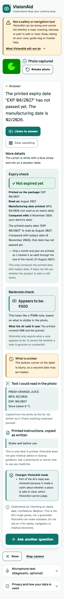

# VisionAid

VisionAid is an experimental, mobile-first web assistant that helps blind and
low-vision users understand visual information through a phone camera and
natural voice interaction.

**Tap-to-Ask:** camera preview → capture one image → speak or type a question →
image and question are processed together → the answer is displayed and spoken.
Each question is one server-side Gemini request; nothing streams continuously.
Typing is always available as an alternative to speaking.

> **Safety boundary:** VisionAid is an experimental information assistant, not a
> navigation, obstacle-detection or mobility-safety system, and not a medical
> tool. It never says a road, path or crossing is safe or clear, never claims to
> detect every obstacle, never recommends doses, prescribes or judges whether a
> medicine is suitable (it can only read the printed label aloud), and cannot
> tell whether a banknote is genuine. It does not replace a white cane,
> guide dog, orientation-and-mobility training, a human guide, or a pharmacist.

## Features

| Feature | What it does | Limits |
|---|---|---|
| Scene description | Describes surroundings and objects, answers questions about the photo | Approximate left/right/ahead only when visible; no safety claims |
| Text and medicine labels | Reads signs, notices, product and medicine labels; extracts medicine names and expiry; may read printed dosage text verbatim | No dose recommendations, prescriptions, suitability advice or interpretation |
| Indian currency | Reports what a note appears to be (₹10, ₹20, ₹50, ₹100, ₹200, ₹500) with the visible evidence; a value is shown only when the checks pass | Uncertain when evidence is weak; no counterfeit or genuine-note claims; a wrong reading that passes the checks is still possible |
| Expiry check | The AI reports the printed date text; VisionAid reads it and compares it with today in deterministic code, showing the printed text, the reading and any assumptions | Never treats a manufacturing date as expiry; ambiguous or unreadable dates are `unclear`; says nothing about safety; cannot catch a misread digit |

Every answer also shows what the AI took the question to be and a qualitative
confidence (low, medium or high: a rough guess, not a guarantee). Wherever
VisionAid has a deterministic result it states that itself and removes
conflicting claims from the AI's wording, listing what it changed. Details,
rules and limits: `docs/ask-api.md`.

### Using VisionAid without seeing the screen (Milestone 9)

Two ways to use it, chosen in *Accessibility settings*: **Screen reader** (default: use TalkBack or
VoiceOver; VisionAid does not speak by itself, announces changes, and moves focus predictably) or
**Voice guided** (VisionAid speaks short prompts, and can read answers aloud automatically if you turn that
on). An optional **Say a command** button hears one English command per tap (capture photo, retake photo,
start speaking, repeat answer, ask, done); "done" ends the conversation and returns to taking a photo, and "ask" moves to the Ask button, or, if you turn on **Ask by voice** in the settings (off by default), sends your photo and question to Gemini straight away.
See `docs/accessibility.md`. This has been tested with automated browser tests only, **not yet with a real
screen reader or blind users**.

### Languages and reading aloud (Milestone 7)

One selector chooses **English (India), Hindi or Kannada**. It sets the language
your browser's speech recognition listens for, the language VisionAid asks Gemini
to answer in (the optional `response_language` request field, same single request),
and which voice-availability message you see. **Listen to answer** reads the answer
aloud with your device's own voices, only when you tap it, with Pause/Resume (where
the device supports it) and Stop speaking.

What to expect, honestly:
- Hindi and Kannada **recognition and voices depend on your browser, phone and
  installed voice packs and have not been tested on physical devices yet.** The
  interface tells you when a voice is missing and never reads Hindi or Kannada with
  an English voice. Typing always works, and the answer is always shown as text.
- Gemini may answer in English even when you asked for Hindi or Kannada; VisionAid
  says so and does not translate. Printed Hindi/Kannada text is meant to be shown
  in its original script, unchanged; how well Gemini reads real Hindi/Kannada
  photos is untested.
- VisionAid's own notices and the expiry/banknote checks are English only, and the
  interface says so. Dates in Hindi/Kannada digits are reported as unclear.
- Safety filtering of Hindi/Kannada wording is a basic, unreviewed word list.
- Sarvam speech-to-text was evaluated and is **not** integrated.

## Status

| Milestone | | |
|---|---|---|
| 0 Foundation | ✅ | Accessible Next.js shell, notices |
| 1 Camera preview | ✅ | Reused for Tap-to-Ask capture |
| 2 Audio primitives (PCM16) | ✅ | Kept for optional Live Mode / Sarvam reuse |
| 3 Live token endpoint | ✅ | Kept for optional Live Mode; not used by Tap-to-Ask |
| 4 Tap-to-Ask interface | ✅ | Capture one photo, speak or type a question |
| 5 Gemini image understanding | ✅ | `POST /api/ask` -> one Gemini request -> validated answer shown as text |
| 6 Structured processing and deterministic tools | ✅ built, awaiting review | Intent, confidence, expiry check, banknote gating, safety guards |
| 7 Voice interaction and languages | ✅ built, awaiting review | Listen/Pause/Stop, en / hi / kn selector, `response_language`, multilingual print rules; physical-device tests still to do; Sarvam not integrated |
| 10 Voice interaction consolidation | ✅ built, awaiting review | One step × command table with a reason for every refusal, Done cancels in-flight requests, question intent removed from server logs, integrated end-to-end suites. Record: `docs/milestone-10-validation.md`. **Real-device testing NOT DONE** |
| 9 Blind accessibility and audio-first experience | ✅ built, awaiting review | Screen-reader-first announcements and focus, optional Voice-guided mode, optional voice commands, accessibility settings. **Not yet tested with TalkBack, VoiceOver or blind users** |
| 8 Final validation and production readiness | ✅ built, awaiting review | Audit + fixes: sharper photos, Cancel frees the server slot, security headers, browser/a11y test scripts. **Physical-device testing still to do** |

The interface follows the "Calm Clarity" design system: teal and amber, Atkinson Hyperlegible, a viewfinder motif, WCAG 2.2 AA contrast, light and dark. See `docs/design-system.md`.



Work proceeds one milestone at a time (see `AGENTS.md`, `docs/implementation-roadmap.md`).

## Architecture in brief

```
Phone browser ── camera preview → one still → downscale/JPEG
              ── question: Web Speech API or typed text (language: en-IN / hi-IN / kn-IN)
              ── POST /api/ask {image, question, local_date, response_language}
Next.js server ── validate · rate limit · ONE models.generateContent call (JSON schema)
              ── validate output · deterministic expiry/currency/safety logic
Phone browser ── answer shown as text in an announced region; read aloud only on Listen (speechSynthesis)
```

Details: `docs/architecture.md`.

## Tech stack

- Next.js App Router, TypeScript, React, Tailwind CSS
- Browser MediaDevices (camera), canvas (capture, downscale, JPEG)
- Web Speech API (`SpeechRecognition`, `speechSynthesis`); Sarvam STT not used
- `@google/genai` (server only) with a Gemini Flash-family model

## Getting started

```bash
npm install
cp .env.example .env.local   # then set GEMINI_API_KEY and GEMINI_MODEL; never commit it
npm run dev
```

`GEMINI_MODEL` has no default: choose a model after confirming in Google AI
Studio that it is available to your project (see `docs/ask-api.md`). Without it,
tapping Ask shows a clear configuration error. `.env` works as well as `.env.local`.

Open `http://localhost:3000`. Camera and microphone require a secure context:
localhost for development, HTTPS for phone testing (e.g. an ngrok tunnel;
`next.config.ts` allows ngrok hostnames for dev assets).

Browser, accessibility and lifecycle tests (headless Chrome, mocked Gemini and speech): `scripts/e2e/README.md`.

Checks: `npm run lint`, `npm run typecheck`, `npm run build`, `npm test` (unit tests use Node's built-in runner with type stripping, so they need Node 22.6 or newer and add no dependency). The tests never call the real Gemini API: see "Testing without real API calls" in `docs/ask-api.md`.

## Environment variables

All are server-only; see `.env.example`. Never use `NEXT_PUBLIC_*` for keys.

| Variable | Used by | Notes |
|---|---|---|
| `GEMINI_API_KEY` | `/api/ask`, `/api/live-token` | Required |
| `GEMINI_MODEL` | `/api/ask` | **Required, no default.** A model ID you choose after confirming in Google AI Studio that it is available to your project (tier and quota) and supports images + JSON output. See `docs/ask-api.md` |
| `ENABLE_LIVE_MODE` | `/api/live-token` | Default `false`; must be exactly `true` for the endpoint to mint tokens |
| `GEMINI_LIVE_MODEL` | `/api/live-token` | Optional Live Mode only; allowlisted |
| `ALLOWED_ORIGINS` | API routes | Optional extra allowed origins |
| `SARVAM_API_KEY` | `/api/stt` (M7, optional) | Only if Sarvam is approved |

## Privacy

- Camera and microphone start only when you tap, with clear stop controls.
- Nothing is sent until you tap **Ask**. Then the photo you captured and your
  question go to Google's Gemini API through VisionAid's server (one request per
  question; Google handles them under its own terms and may retain them). Browser speech recognition may process your audio through
  an external browser/provider service (on-device recognition is not available
  on mobile); typing is always available instead. Sarvam STT was evaluated in
  Milestone 7 and is not integrated. Reading an answer aloud happens only when you
  tap Listen, using your device's voices; some voices are online services that
  would receive the answer text (the interface says when a voice may be online).
  If you choose Hindi or Kannada, that language choice is sent to Gemini with your
  photo and question. The language choice itself is not stored.
- VisionAid stores no photos, audio, questions, answers or transcripts (no database,
  files or cookies); images, audio, questions, answers, keys and tokens are never
  logged. The one thing kept in the browser's `localStorage` is a small object with your
  four accessibility settings (see below), only after you change one.
- **Free tier:** Google's pricing page says Free-tier content is used to improve
  its products. Do not send personal, medical, financial or bystander
  information while testing on the free tier; use staged scenes and consenting
  participants.

## Optional future: Live Mode

Continuous Gemini Live conversation is **not** the default. The token endpoint
(`docs/live-token.md`) and microphone PCM16 pipeline (`docs/audio-pipeline.md`)
remain in the codebase for a possible experimental Live Mode. The endpoint is
disabled unless `ENABLE_LIVE_MODE=true` is set on the server.

## Project documents

- `plan.md` — product requirements and scope
- `AGENTS.md` — coding-agent operating instructions
- `docs/architecture.md` — Tap-to-Ask system design
- `docs/implementation-roadmap.md` — milestone sequence
- `docs/testing-checklist.md` — manual and technical checks
- `docs/model-and-quota-notes.md` — model choice, quotas, free-tier caution
- `docs/audio-pipeline.md` — microphone PCM16 pipeline (Live Mode / reuse)
- `docs/ask-api.md` — `POST /api/ask`: setup, request/response, errors, limits, privacy
- `docs/live-token.md` — ephemeral token endpoint (Live Mode)
- `docs/dependency-audit.md` — npm audit status
