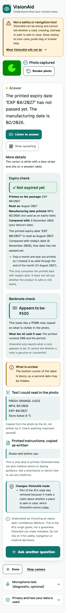

# Design system: Calm Clarity

VisionAid is used mainly by blind and low-vision people, so the interface is built
for legibility and calm first, and decoration second. This is a visual and
interaction redesign only: no behaviour, API, safety rule or privacy rule changed.

Source of truth: `src/app/globals.css` (tokens and component classes),
`src/app/layout.tsx` (fonts), `src/components/*` (components).

More previews are in `docs/screenshots/` (mobile and desktop, light and dark).

## Direction

Deep teal for trust and action; one warm amber used sparingly (the logo's spark, the
answer marker, caution surfaces); white and soft teal-grey surfaces; generous
spacing; one rounded-corner scale. The memorable element is the **viewfinder**: soft
corner marks drawn in the frame's padding around the camera and the captured photo,
never over the picture. Everything else stays quiet.

## Colour

Both themes follow the system setting (no theme switcher). Every pair below was
computed against WCAG 2.2 AA (normal text 4.5:1, UI components and graphics 3:1).

| Role | Light | Dark |
|---|---|---|
| Background | `#F7FAF9` | `#0C1716` |
| Surface (cards, inputs) | `#FFFFFF` | `#122321` |
| Secondary / elevated surface | `#EAF3F1` | `#1A302D` |
| Primary text | `#142B2A` (14.2:1 on background) | `#F2F7F5` (16.9:1) |
| Secondary text | `#526A67` (5.5:1) | `#B5C8C2` (10.4:1) |
| Primary (buttons, links, focus) | `#0F766E` (white text 5.5:1) | `#5EEAD4` (dark text 12.4:1) |
| Primary hover | `#115E59` | `#99F6E4` |
| Accent (amber, sparing) | `#F4B860` (dark text 8.4:1) | `#F4B860` |
| Border (decorative) | `#D5E2DE` | `#2B4540` |
| Border, form controls | `#6B8782` (3.4–3.9:1) | `#6B8F88` (3.9–5.1:1) |
| Success surface / text | `#E4F4EA` / `#0F4D2B` (8.7:1) | `#12301F` / `#C4F1D5` (11.5:1) |
| Caution surface / text | `#FFF3DC` / `#3A2A05` (12.6:1) | `#2E2308` / `#FBE3B3` (12.3:1) |
| Error surface / text | `#FDECEA` / `#5A1410` (11.9:1) | `#331513` / `#FFD3CE` (12.3:1) |

The form-control border is a separate, stronger token because the decorative border
(`#D5E2DE`, about 1.3:1 on white) would fail the 3:1 rule for the edge of an input.
**Status is never colour alone**: errors, cautions and successes always carry an icon
or symbol and words (`✓ Not expired yet`, `✕ Expired`, `? Unclear`, "Could not get an
answer" with an icon, "Camera on" / "Camera off" chips).

## Typography

- **Atkinson Hyperlegible** (400, 700) for body and controls: designed by the Braille
  Institute for low-vision readers (distinct letterforms, e.g. I / l / 1).
- **Manrope** (variable, 600–800) for headings and key results.
- Both are self-hosted (`src/app/fonts/`, OFL licences in `LICENSES.md`), Latin subset,
  loaded with `next/font/local`: no request to a font service, about 60 KB in total.
- Hindi (Devanagari) and Kannada are not covered by either face and use the device's
  own fonts (Noto Sans Devanagari/Kannada, Kohinoor, Kannada Sangam MN, Nirmala UI);
  text in those scripts carries a `lang` attribute.
- Scale (all in `rem`, so browser/OS text enlargement scales everything): root 112.5 %
  (18 px body), caption 15 px minimum, 18–20 px labels and sub-headings, 24 px answer
  text, 24–28 px page title. No weight below 400; line height 1.5–1.6.

## Shape, depth, motion

- Radius: 12 px controls, 20 px cards and the camera frame, full pills for status chips.
- Depth: one hairline-plus-soft-shadow for raised cards (the answer, the sending card);
  everything else is flat with a 1 px border.
- Motion: button hover/pressed (150 ms), one 260 ms rise when a new step appears (photo,
  question, answer, error), the listening dot and spinners. `prefers-reduced-motion`
  turns all of it off (verified: transitions become 0.01 ms).

## Components (what they are for)

| Component | Use |
|---|---|
| `ActionButton` (`.btn`) | Primary (one per step: Start camera, Capture photo, Ask, Ask another question), secondary (Retake, Cancel, Stop), quiet (Stop camera). Icon is decorative; the label carries the meaning. Min 48 px high, full-width + 60 px for the main action. Uses `aria-disabled` so the button keeps its place. |
| `CameraPreview` | Viewfinder frame, persistent status chip (`role="status"`), empty / waiting / live states. |
| `CapturedImageReview` | Photo in the same frame, Retake, advisory quality tip. After a question is sent it shrinks to a thumbnail on phones so the answer stays near the top; on desktop it stays full-size beside the answer. |
| `LanguageSelector` | One select (shown in the question step). Voice or speech-input problems appear as a caution; when all is well that information stays available to screen readers only. |
| `QuestionInput` | Label, textarea, Start/Stop speaking, listening indicator, errors. |
| `SendingView` / `SendFailure` | Calm card with spinner and the question; failure with icon, words, Try again and Edit question. |
| `AnswerView` | Answer first (24 px) and Listen/Pause/Stop; then the app's own expiry and banknote results, what is unclear, printed text and instructions (clearly attributed), changes VisionAid made, and the confidence caption. Sections appear only when there is data. |
| `SafetyNotice`, `PrivacyNotice` | Safety limit always visible in one short caution; detail and the full privacy text in expandable sections. |

Callouts (`.callout-warning|danger|success|info`) have a tinted surface, a 5 px edge,
an icon and text. Icons are Lucide (ISC), copied as path data into `Icon.tsx`
(no dependency).

## Layout

- One column on phones, in the order a person works: safety strip, camera or photo,
  primary action, question, answer. Content gutters follow the viewport
  (`min(1rem, 4vw)`), so enlarged text keeps room.
- From the `lg` breakpoint (1024 px) the picture (camera, then the photo) sits on the left
  and stays in view while the question and then the answer use the right.
- Content width is capped at 64 rem.

## Accessibility additions (Milestone 9)

A visible step heading ("Step 1 of 3: Take a photo") sits above the stage; *Accessibility settings* is a
collapsed card at the top whose heading shows the current mode; in voice-guided mode or with commands on, a
*Voice controls* card (Stop VisionAid voice, Say a command) appears in the same place every time. They use
the existing card, button, callout and chip styles. See `docs/accessibility.md`.

## What was removed or moved

| Before | Now |
|---|---|
| "What it is" intro and the "Experimental prototype" label | One-line tagline under the name |
| Long safety panel | One-sentence caution, always visible, plus "What VisionAid will not do" (expandable) |
| "Status: ..." line and the Camera / Microphone / AI service tiles | A single camera status chip; the listening and sending states are shown where they happen |
| Language selector with three explanatory paragraphs, shown before any photo | One compact control in the question step; problems are shown, normal availability is for screen readers only |
| "Step 1…", "Ready. Tap Ask…", "Your photo and question stay on this device…" | Removed (repeated information); the Ask button keeps its one-sentence Gemini disclosure |
| Large Privacy block | "Privacy and how your data is used" (expandable, full text kept) |
| Microphone test | Still there, as a quiet expandable row |

Kept visible on purpose: the safety limit, the sentence beside Ask saying the photo and
question are sent to Google's Gemini service, every error and announcement, the
"Copied from the photo by the AI, not written by it" and "Changes VisionAid made"
attributions, and the confidence caption with its "rough guess, not a guarantee".

## Verification (2026-11-06)

Automated, on a production build in headless Chrome (see `scripts/e2e/`):
- axe-core with WCAG 2.0/2.1/2.2 A and AA and best-practice rules: **0 violations** at 320,
  360, 390, 430, 768 and 1280 px, light and dark, in the start, camera, photo, answer and
  failure states. Needs-review items are only the white-on-translucent-black "Camera on"
  chip over live video (checked by hand: at least 10:1 even over a white frame) and
  "video has no captions" (the preview has no audio).
- No interactive target below 44 × 44 px; no horizontal scroll at any width, and none with
  text enlarged to 200 % at 390 px and 320 px.
- Reduced motion honoured. Focus lands on the photo, answer and failure headings.
- Not verified here: real phones, real screen readers (VoiceOver, TalkBack), forced-colors
  / high-contrast mode, colour-blindness simulation beyond "never colour alone".

## Known limitations

- With text enlarged to 200 % on a 320–390 px phone, a few long words (for example the
  name in the title) break across lines; nothing overflows or is lost.
- The brand and amber accents are decorative; they carry no information.
- Hindi and Kannada use system fonts, so their look differs by device.
